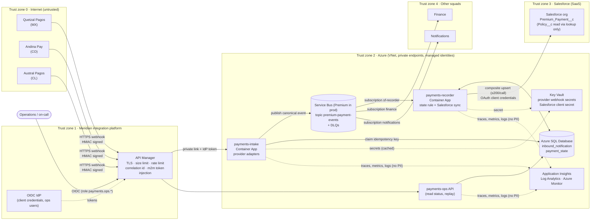

# Solution design — Premium Payment Notifications

> Scope: FR1–FR7 and NFR1–NFR9 for Mexico (Quetzal Pagos), Colombia (Andina Pay) and Chile (Austral Pagos).
> Decisions are recorded in [ADR-0001](../adr/0001-salesforce-integration.md), [ADR-0002](../adr/0002-stack-and-data-store.md) and [ADR-0003](../adr/0003-ordering-by-latest-state-sync.md). Assumptions are numbered `A-n` and listed in [`ASSUMPTIONS.md`](../ASSUMPTIONS.md).

## 1. Summary

The flow is split into three stages, each with a single responsibility and joined by durable state:

1. **Intake** (`payments-intake`, stateless HTTP service). It verifies the provider signature on the raw bytes, translates the notification into the **canonical payment event**, claims its **idempotency key**, publishes the event to a Service Bus topic and only then answers `2xx`. Everything that is provider-specific lives in one *provider adapter* per provider (signature, parsing, mapping, idempotency key, policy reference normalization).
2. **Recorder** (`payments-recorder`). It consumes the topic, applies each event to a **payment state** row with a monotonic state-precedence rule (this is where ordering is resolved) and records the outcome of every notification for operations.
3. **Salesforce sync** (a single active worker inside the recorder). It writes the **latest state** of every changed payment to Salesforce in batches of up to 200 records per API call, with backoff, a circuit breaker on `REQUEST_LIMIT_EXCEEDED` and parking of records that Salesforce rejects for data reasons.

Downstream consumers (Finance, Notifications) subscribe to the same topic with their own subscriptions (FR6). Nothing writes `Policy__c` (the integration never touches policy status).

## 2. Context diagram and trust boundaries



| Boundary | What crosses it | Control |
|---|---|---|
| 0 → 1 | Provider webhook | TLS 1.2+, body ≤ 64 KB, rate limit per provider, optional source IP allow list where the provider publishes ranges (A-3). The API Manager does **not** verify the HMAC: it needs the raw body and the provider secret, which stay in Azure. |
| 1 → 2 | Forwarded webhook (raw body + provider headers) | Private connectivity (A-2). The API Manager attaches an IdP machine-to-machine token; the intake rejects calls without a valid token for its audience, so nobody can bypass the API Manager. |
| inside 2 | Secrets, messages, state | Managed identities with data-plane roles only (Key Vault Secrets User, Service Bus Data Sender / Receiver per entity, SQL contained users). Public network access disabled; private endpoints. |
| 2 → 3 | Payment records | OAuth client credentials (secret in Key Vault), token cached ~2 h, API budget enforced by the sync worker. |
| 2 → 4 | Canonical event | Each consumer has its own subscription and its own identity with `Data Receiver` on **its** subscription only. The event carries **no payer personal data**. |

## 3. Sequence for one notification, with failure paths

```mermaid
sequenceDiagram
  autonumber
  participant P as Provider
  participant G as API Manager
  participant I as payments-intake
  participant DB as Azure SQL
  participant T as Service Bus topic
  participant R as payments-recorder
  participant S as Salesforce sync (leader)
  participant SF as Salesforce

  P->>G: POST /webhooks/{provider} (raw body + signature headers)
  G->>I: forward + X-Correlation-Id + m2m token
  I->>I: adapter.verify(raw bytes, headers, secrets, clock)
  alt signature invalid, missing or timestamp outside window
    I-->>G: 401 (nothing stored, metric + warn log without body)
    G-->>P: 401 — provider retries; alert if rate > 0
  end
  I->>I: parse + map to canonical event + normalize policy reference
  alt body unparseable or unknown state/type
    I-->>P: 400 / 422 (not accepted, provider keeps it on its side) + alert
  end
  I->>DB: claim(idempotencyKey)
  alt key already PUBLISHED (duplicate or provider retry)
    DB-->>I: ALREADY_PUBLISHED
    I->>DB: record attempt as DUPLICATE (for FR7)
    I-->>P: 200 (acknowledge, do not publish again)
  else new key, or claimed earlier but never published
    I->>T: send(canonical event, messageId = idempotencyKey) — timeout 3 s
    alt Service Bus or SQL unavailable
      I-->>P: 503 (NOT accepted → provider retries; NFR3 holds)
    else published
      I->>DB: mark PUBLISHED
      I-->>P: 200 (Andina) / 2xx
    end
  end

  T->>R: deliver (peek-lock)
  R->>DB: apply event to payment_state (precedence rule, optimistic concurrency)
  alt event is older or weaker than current state
    R->>DB: notification SUPERSEDED (kept for audit, not sent to Salesforce)
  else state advanced
    R->>DB: payment_state.dirty = true, notification APPLIED
  end
  R->>T: complete
  Note over R,T: SQL down → abandon with backoff (scheduled re-enqueue);<br/>after 10 deliveries → subscription DLQ

  loop every 5 s (or when 200 dirty rows are waiting)
    S->>DB: take ≤ 200 dirty rows per request, ≤ 5 requests in parallel
    S->>SF: PATCH composite/sobjects/Premium_Payment__c/Payment_Key__c (allOrNone=false)
    alt 2xx with per-record results
      SF-->>S: success → RECORDED (dirty cleared if version unchanged)
      SF-->>S: 400 INVALID_FIELD (policy not found) → NEEDS_ATTENTION, no retry, alert
      SF-->>S: 400 UNABLE_TO_LOCK_ROW → retry that record with backoff
    else 401 INVALID_SESSION_ID
      S->>SF: refresh token once, retry the request
    else 500/502/503 or timeout
      S->>S: exponential backoff, circuit breaker opens after 5 consecutive failures
    else 403 REQUEST_LIMIT_EXCEEDED
      S->>S: stop all calls for 15 min (half-open probe with one call), page on-call
    end
  end
```

Why the intake answers only **after** the publish: a notification is *accepted* when Meridian returns `2xx` (NFR3). Publishing first and acknowledging later means the only possible failure mode is a duplicate (crash between publish and response), which idempotency absorbs; the opposite order could lose payments.

Time budget against the strictest provider timeout (Andina, 5 s): signature + mapping < 5 ms, SQL claim p99 ≈ 20 ms, Service Bus send p99 ≈ 100 ms; the send has a hard 3 s timeout so the intake always answers before 5 s.

## 4. Canonical payment event

Envelope: **CloudEvents 1.0** (JSON structured mode). The contract is [`docs/api/events/premium-payment.schema.json`](../api/events/premium-payment.schema.json).

| Field | Type | Meaning |
|---|---|---|
| `specversion` | `"1.0"` | CloudEvents version. |
| `id` | UUID | Unique id of this canonical event instance. |
| `type` | `com.meridian.payments.premium-payment.status-changed` | Single event type; the new status is in `data.status`. |
| `source` | URI | `/payments-intake/{provider}` |
| `time` | date-time | When Meridian received the notification. |
| `dataschema` | URI | `…/premium-payment/1.0` — **major version in the URI**; see versioning below. |
| `datacontenttype` | `application/json` | |
| `subject` | string | `paymentKey` (lets consumers filter/partition). |
| `correlationid` | string | CloudEvents extension; end-to-end correlation id (NFR7). |
| `data.schemaVersion` | `"1.0"` | Duplicated inside `data` for consumers that read only the payload. |
| `data.idempotencyKey` | string | Business identity of this event (section 5). Consumers must deduplicate on it. |
| `data.paymentKey` | string | `{PROVIDER}:{providerTransactionId}`; the value written to `Payment_Key__c`. |
| `data.country` | `MX`/`CO`/`CL` | |
| `data.provider` | `QUETZAL`/`ANDINA`/`AUSTRAL` | |
| `data.providerTransactionId` | string | Charge / transaction / payment id. |
| `data.providerEventId` | string | `id` / `notificacion_id` / `eventId` of this attempt. |
| `data.providerEventType` | string | Raw provider state/type, kept for audit. |
| `data.status` | `PENDING`/`CAPTURED`/`FAILED`/`REFUNDED` | Canonical lifecycle. |
| `data.statusChangedAt` | date-time (UTC) | When the state changed **at the provider** (drives ordering). |
| `data.amount` | `{value: string, currency: ISO 4217}` | Decimal string in the major unit with the currency's exponent (`"1250.00"` MXN, `"185000.00"` COP, `"45990"` CLP). Never a float. |
| `data.amountRefunded` | money \| null | Only for refunds when the provider reports it. |
| `data.policy.reference` | string | Reference as received from the provider. |
| `data.policy.number` | string \| null | Normalized `POL-CC-NNNNNNNNN`, or `null` when it cannot be normalized. |
| `data.policy.referenceStatus` | `VALID`/`NORMALIZED`/`INVALID` | Makes the Andina 2.3 change visible instead of failing in Salesforce. |
| `data.paymentMethodType` | string | `CARD`, `BANK_TRANSFER`, `CASH`, `OTHER`. Never a token or card data. |
| `data.reason` | string \| null | `failure_code` or `motivo_reverso`. |

**Payer personal data (name, national ID, email) is deliberately not in the canonical event.** No consumer needs it to process a payment, and leaving it out keeps logs, the broker, the operational store and every downstream subscription out of scope of personal-data processing (NFR6). Consumers that must contact the payer (Notifications) look the customer up in Salesforce by policy number.

### Mapping

| Canonical | Quetzal (MX) | Andina (CO) | Austral (CL) |
|---|---|---|---|
| `status` | `charge.succeeded`→`CAPTURED` · `charge.failed`→`FAILED` · `charge.refunded`→`REFUNDED` | `PENDIENTE`→`PENDING` · `APROBADA`→`CAPTURED` · `RECHAZADA`→`FAILED` · `REVERSADA`→`REFUNDED` | `PAYMENT_CONFIRMED`→`CAPTURED` · `PAYMENT_REJECTED`→`FAILED` · `PAYMENT_REVERSED`→`REFUNDED` |
| unknown state/type | rejected `422` + alert (never defaulted to `PENDING`) | same | same |
| `providerTransactionId` | `data.charge.id` | `transaccion.id` | `payment.paymentId` |
| `providerEventId` | `id` | `notificacion_id` | `eventId` |
| `statusChangedAt` | `paid_at` (succeeded) · `refunded_at` (refunded) · `created` (failed or null timestamps); Unix s → UTC | `transaccion.fecha_transaccion` (offset → UTC) | `payment.occurredAt` |
| `amount.value` | `data.charge.amount` ÷ 100 (minor → major, A-6) | `transaccion.valor` as decimal | `payment.amount` (CLP exponent 0) |
| `amount.currency` | `data.charge.currency` upper-cased | `transaccion.moneda` | `payment.currency` |
| `amountRefunded` | `amount_refunded` ÷ 100 | `null` (reversal is total, A-7) | `null` (A-7) |
| `policy.reference` | `data.charge.reference` | `transaccion.referencia` | `payment.policyNumber` |
| `paymentMethodType` | `payment_method.type` (`card`→`CARD` …) | `medio_pago`: `TARJETA`→`CARD`, `PSE`→`BANK_TRANSFER`, `EFECTIVO`→`CASH` | not provided → `OTHER` |
| `reason` | `failure_code` | `motivo_reverso` | — |
| payer data | `customer.email` — **dropped** | `pagador` — **dropped** | `payer` — **dropped** |

**Policy reference normalization** (lesson of INC-0412): trim, upper-case, remove inner spaces; `POL-{CC}-\d{9}` with the provider's country → `VALID`/`NORMALIZED`; nine digits alone → prefixed with `POL-{CC}-` (`NORMALIZED`, A-8); anything else, or a country prefix that does not match the provider's country → `INVALID`, `policy.number = null`. Invalid references are still accepted and published (the money was received); the recorder parks them as `NEEDS_ATTENTION` instead of sending them to Salesforce.

## 5. Idempotency and ordering (FR4, FR5)

### Keys

| Provider | Idempotency key (one business event) | Why | Payment key (`Payment_Key__c`) |
|---|---|---|---|
| Quetzal | `QUETZAL:{id}` | `id` is stable across retries; two partial refunds of one charge are two different events with two ids. | `QUETZAL:{data.charge.id}` |
| Andina | `ANDINA:{transaccion.id}:{transaccion.estado}` | `notificacion_id` **changes on every retry**; the spec says the pair transaction + state identifies the business event. | `ANDINA:{transaccion.id}` |
| Austral | `AUSTRAL:{eventId}` | Stable across retries, identical body. | `AUSTRAL:{payment.paymentId}` |

The payment key is prefixed with the provider because transaction ids are only unique within a provider; it fits `Text(80)`.

### Where it is enforced (defence in depth)

1. **Intake** — `inbound_event` table, unique on `idempotency_key`. A key already `PUBLISHED` is acknowledged without publishing again. The claim is a short **lease** (`claimed_until`, 10 s > the 3 s publish timeout): a concurrent delivery of the same event gets `503` and retries, a failed publication releases the lease, and an expired lease (crash) lets the next retry publish. The claim never blocks a retry for long, so it cannot cause loss.
2. **Recorder** — the precedence rule below is idempotent by construction: applying the same event twice is a no-op. This covers duplicates the intake cannot see (crash between publish and `mark PUBLISHED`, DLQ replays).
3. **Salesforce** — upsert by external id `Payment_Key__c`: re-sending a record updates it, it never creates a second payment. *Exactly once in business terms* = one `Premium_Payment__c` per payment, whose status reflects the latest real state.
4. **Consumers** — the contract requires them to deduplicate on `idempotencyKey` (at-least-once delivery is documented in `docs/api/README.md`).

### Ordering: monotonic state precedence

Notifications arrive out of order for every provider, so ordering is resolved on **state**, not on arrival:

| Rank | Status | Can move to |
|---|---|---|
| 0 | `PENDING` | anything of higher rank |
| 1 | `FAILED`, `CAPTURED` | `REFUNDED` (from `CAPTURED`), or the other rank-1 state if its `statusChangedAt` is later (anomaly, logged) |
| 2 | `REFUNDED` | nothing — terminal |

Implemented and tested as a pure domain function, `PaymentStatePrecedence` (`practical/`); the tests check that every arrival order of the real samples converges to the same final state. An incoming event is applied when `rank(new) > rank(current)`, or `rank(new) == rank(current)` with a later `statusChangedAt` (also used to keep the largest `amountRefunded` for successive partial refunds). Otherwise it is recorded as `SUPERSEDED`. The update is a single conditional `UPDATE … WHERE payment_key = @k AND row_version = @v` (optimistic concurrency), retried on conflict.

Examples: `REVERSADA` arriving before `APROBADA` → the payment is created as `REFUNDED`; the late `APROBADA` is superseded and Salesforce never shows a refunded payment as captured (FR5). A retried `PENDIENTE` after `APROBADA` is superseded.

Salesforce is then written from the **current state**, never from the event, by a single active sync worker (leader election with an Azure SQL application lock, `sp_getapplock`, held by the sync loop's session). Two workers can therefore never race and write an older state after a newer one; a row that changes while it is being written stays dirty and is written again in the next cycle. See ADR-0003 for the alternatives (Service Bus sessions, conditional writes in Salesforce).

## 6. Error handling

| Stage | Failure | Retry? | How / for how long | Then |
|---|---|---|---|---|
| Intake | Invalid/missing signature, stale timestamp | No | — | `401`, metric `intake.signature.failed{provider}`, alert on any sustained rate (possible secret rotation or attack). |
| Intake | Malformed body, unknown state/type | No | — | `400` / `422`, alert. Not accepted, so the provider keeps it and retries (Quetzal 3 days, Austral 48 h, Andina 24 h) while we fix the adapter. |
| Intake | SQL or Service Bus unavailable/slow | By the provider | We answer `503` within the timeout | Not accepted → no loss. Alert on intake `5xx` rate. |
| Recorder | SQL transient error, concurrency conflict | Yes | Abandon with scheduled redelivery (2 s, 4 s … up to 5 min); max delivery count **10** | Subscription DLQ (`MaxDeliveryCountExceeded`). |
| Recorder | Event fails schema validation | No | — | Dead-lettered immediately with reason `SchemaValidationFailed`. |
| Sync | `5xx`, timeout, `UNABLE_TO_LOCK_ROW` | Yes | Per-record exponential backoff with jitter (5 s → 15 min cap), **no limit while the payment is younger than 72 h**; circuit breaker for the whole worker | After 72 h without success → `FAILED_PERMANENT`, alert. Records simply wait in SQL; nothing is lost while Salesforce is down. |
| Sync | `401` | Once | Refresh token, retry request | If it fails again → treat as `5xx` and page (credential problem). |
| Sync | `403 REQUEST_LIMIT_EXCEEDED` | Only after recovery | Global pause 15 min, then one probe call | Page on-call; we are hurting other integrations of the org. |
| Sync | `400 INVALID_FIELD` / validation errors | **No** | — | `NEEDS_ATTENTION` with the Salesforce error code; alert per country. Never retried in a loop (INC-0412 burned 43,120 calls that way). |

**Dead-letter queues**: each subscription has one (Service Bus native). Our own sync stage does not need a queue-based DLQ because its "parking" is a status in SQL (`NEEDS_ATTENTION`, `FAILED_PERMANENT`), visible through the ops API (FR7).

**Safe replay**: replay is always *re-apply*, never *re-insert*:
- DLQ messages are re-submitted to the topic by the ops API (`POST /ops/replays`, role `payments.ops.replay`, audited) with an application property `target=sf-recorder` so only the recorder subscription receives them (subscription SQL filters), not Finance/Notifications. Because the recorder is idempotent and precedence-guarded, replaying old or duplicate events cannot regress a payment.
- `NEEDS_ATTENTION` rows are fixed (e.g. corrected policy number recorded by operations) and simply marked dirty again; the sync writes the **current** state.
- Replays are done in order of `statusChangedAt`, in batches, with the sync's API budget guard active.

## 7. Capacity (NFR1, NFR2, NFR5)

| Quantity | Normal day | Month-end peak day | Burst |
|---|---|---|---|
| Notifications | 15,000 (0.17/s) | 120,000 (1.4/s average) | 40/s for 15 min = 36,000 |
| After 3% duplicates | 14,550 | 116,400 | 34,920 |
| Salesforce calls, one per record (rejected design) | 14,550 | 116,400 = **78% of budget** before any retry | 40 req/s > what 25 concurrent requests at p95 1.2 s sustain (≈ 20/s) |
| Salesforce calls, batched (this design) | ≤ 1 call / 5 s cycle with changes ⇒ ≤ 17,280 | ≤ 17,280 + 600 (records > 200 per cycle) ≈ **12% of budget** | 34,920 records / 200 = 175 calls over 15 min |

- **Throughput:** the sync takes up to 5 parallel requests × 200 records; at p95 4 s per call that is **≈ 250 records/s**, more than 6× the 40/s burst, using 5 of the 25 agreed concurrent requests.
- **API budget:** the worst case is bounded by the cycle count, not by volume: 86,400 s / 5 s = 17,280 calls/day, plus ≈ 12 token requests. Retries during a Salesforce outage do not multiply calls because the circuit breaker stops calling (probe every 30 s ⇒ ≤ 180 calls in a 90 min outage). A hard guard stops the worker at **80% of the 150,000 budget** (rolling 24 h, counted in SQL) and pages.
- **Salesforce outage (97%):** during a 90-minute outage at the busiest peak hour (≈ 5/s) about 27,000 records accumulate in SQL; they drain in ≈ 2 minutes (≈ 135 calls).
- **Freshness (NFR2):** normal path latency is intake (< 0.2 s) + Service Bus (< 1 s) + recorder (< 1 s) + up to 5 s cycle + composite p95 4 s ≈ **11 s**. Only notifications that arrive during a Salesforce outage miss 5 minutes. 97% availability is ≈ 22 h of downtime a month (≈ 3% of the time), so **95% within 5 minutes is met** as long as Meridian's own components are healthy. **99.5% within 1 hour is at risk**: in an outage longer than 60 minutes, every notification received in its first `(duration − 60)` minutes misses the hour. If the 22 h came as ~15 windows of 90 minutes, ≈ 1% of payments would miss 1 h. This cannot be fixed by the integration; it is reported as an SLO risk in [`OPERATIONS.md`](../operations/OPERATIONS.md) and should be agreed with the Salesforce team (A-12).
- **Azure side:** intake 2–10 replicas (0.5 vCPU each, ~100 req/s per replica), recorder 1–5 replicas scaled on subscription backlog (KEDA). Service Bus (1 Premium messaging unit in prod) handles thousands of msg/s; Azure SQL writes are ≈ 3 per notification (< 150 writes/s at burst).

## 8. Data persisted outside Salesforce

Salesforce stays the system of record. We keep only **operational state** needed for idempotency, ordering and FR7, in **Azure SQL Database** (ADR-0002). No payer personal data and no raw bodies are stored. The schema below is the Flyway migration [`db/migrations/V1__operational_state.sql`](../../db/migrations/V1__operational_state.sql) (abridged here), applied by the CD pipeline.

```sql
-- One row per business event (idempotency) and its processing status.
CREATE TABLE inbound_event (
  idempotency_key      NVARCHAR(160) NOT NULL PRIMARY KEY,
  payment_key          NVARCHAR(80)  NOT NULL,
  country              CHAR(2)       NOT NULL,
  provider             VARCHAR(16)   NOT NULL,
  provider_txn_id      NVARCHAR(80)  NOT NULL,
  canonical_status     VARCHAR(16)   NOT NULL,
  status_changed_at    DATETIME2(3)  NOT NULL,
  canonical_event      NVARCHAR(MAX) NOT NULL,  -- JSON, no PII; used for replay
  processing_status    VARCHAR(20)   NOT NULL,  -- RECEIVED, PUBLISHED, APPLIED, SUPERSEDED, RECORDED, NEEDS_ATTENTION, FAILED_PERMANENT, DEAD_LETTERED
  last_error_code      VARCHAR(64)   NULL,
  correlation_id       VARCHAR(64)   NOT NULL,
  first_received_at    DATETIME2(3)  NOT NULL,
  updated_at           DATETIME2(3)  NOT NULL
);
CREATE INDEX ix_inbound_event_txn    ON inbound_event (provider, provider_txn_id);
CREATE INDEX ix_inbound_event_status ON inbound_event (processing_status, country, updated_at)
  WHERE processing_status IN ('NEEDS_ATTENTION','FAILED_PERMANENT','DEAD_LETTERED');

-- One row per delivery attempt, so operations can search by any provider id
-- (Andina's notificacion_id changes on every retry).
CREATE TABLE inbound_attempt (
  attempt_id           BIGINT IDENTITY PRIMARY KEY,
  provider             VARCHAR(16)   NOT NULL,
  provider_event_id    NVARCHAR(80)  NOT NULL,
  idempotency_key      NVARCHAR(160) NOT NULL REFERENCES inbound_event(idempotency_key),
  outcome              VARCHAR(16)   NOT NULL,  -- PUBLISHED, DUPLICATE
  correlation_id       VARCHAR(64)   NOT NULL,
  received_at          DATETIME2(3)  NOT NULL
);
CREATE INDEX ix_attempt_provider_event ON inbound_attempt (provider, provider_event_id);
CREATE INDEX ix_attempt_correlation    ON inbound_attempt (correlation_id);

-- Latest known state per payment: drives ordering and the Salesforce sync.
CREATE TABLE payment_state (
  payment_key          NVARCHAR(80)  NOT NULL PRIMARY KEY,
  country              CHAR(2)       NOT NULL,
  status               VARCHAR(16)   NOT NULL,
  status_changed_at    DATETIME2(3)  NOT NULL,
  last_event_id        NVARCHAR(80)  NOT NULL,
  policy_number        VARCHAR(20)   NULL,
  amount               DECIMAL(16,2) NOT NULL,
  currency             CHAR(3)       NOT NULL,
  amount_refunded      DECIMAL(16,2) NULL,
  sync_status          VARCHAR(20)   NOT NULL,  -- DIRTY, SYNCED, NEEDS_ATTENTION, FAILED_PERMANENT
  sync_attempts        INT           NOT NULL DEFAULT 0,
  next_sync_at         DATETIME2(3)  NULL,
  synced_at            DATETIME2(3)  NULL,
  row_version          ROWVERSION
);
CREATE INDEX ix_payment_state_dirty ON payment_state (next_sync_at) WHERE sync_status = 'DIRTY';
```

- **Size:** ≈ 300k business events a month × ~2 KB ≈ 0.6 GB/month including indexes.
- **Retention:** `inbound_attempt` 90 days; `inbound_event` 13 months (month-over-month reconciliation with Finance, A-10); `payment_state` 13 months after reaching a terminal state. A nightly job deletes in batches. Partitioning is not needed at this size; if volume grows 10×, partition `inbound_event`/`inbound_attempt` by month on `first_received_at` and switch out old partitions.
- **Why not keep everything in Salesforce?** Salesforce is down ≈ 3% of the time and its API is a scarce, shared budget: idempotency, ordering and operational lookups must not depend on it or spend it.

## 9. Operations: finding a notification (FR7)

- **`payments-ops` API**, published in the API Manager, OIDC token from the IdP with role `payments.ops.read` (operations, on-call, contact-center supervisors) or `payments.ops.replay` (on-call only):
  - `GET /ops/notifications?provider=ANDINA&providerEventId=ntf-c02d9e13` → the business event, every attempt, its processing status, the Salesforce outcome and the correlation id.
  - `GET /ops/payments/{paymentKey}` and `GET /ops/notifications?provider=ANDINA&transactionId=TRX-CO-5521907`.
  - `GET /ops/notifications?status=NEEDS_ATTENTION&country=CO` (work queue).
  - `POST /ops/replays` (DLQ or `NEEDS_ATTENTION` items), audited with the caller's identity.
- Responses contain no payer data (none is stored). Every call is logged with the caller identity.
- The correlation id from the response opens the end-to-end trace in Application Insights for deeper analysis; an Azure Monitor workbook shows the same status counts per country for dashboards.
